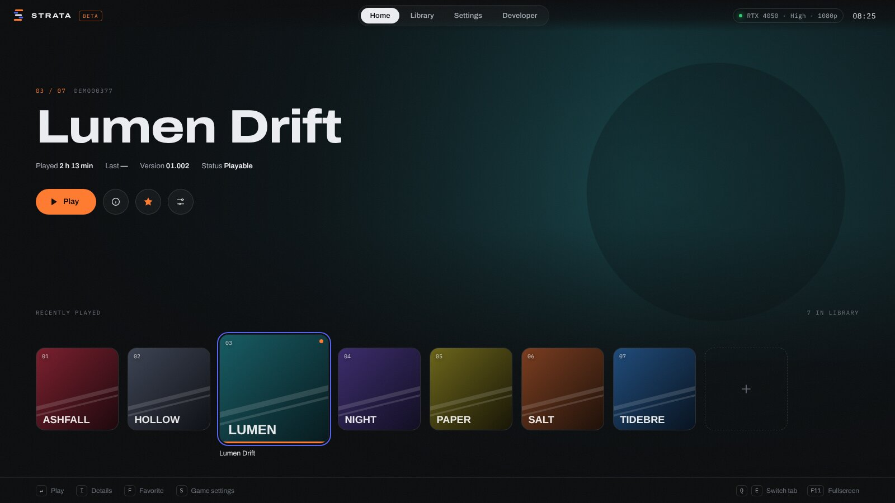
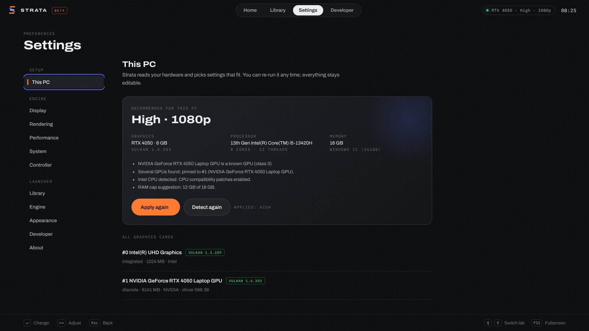
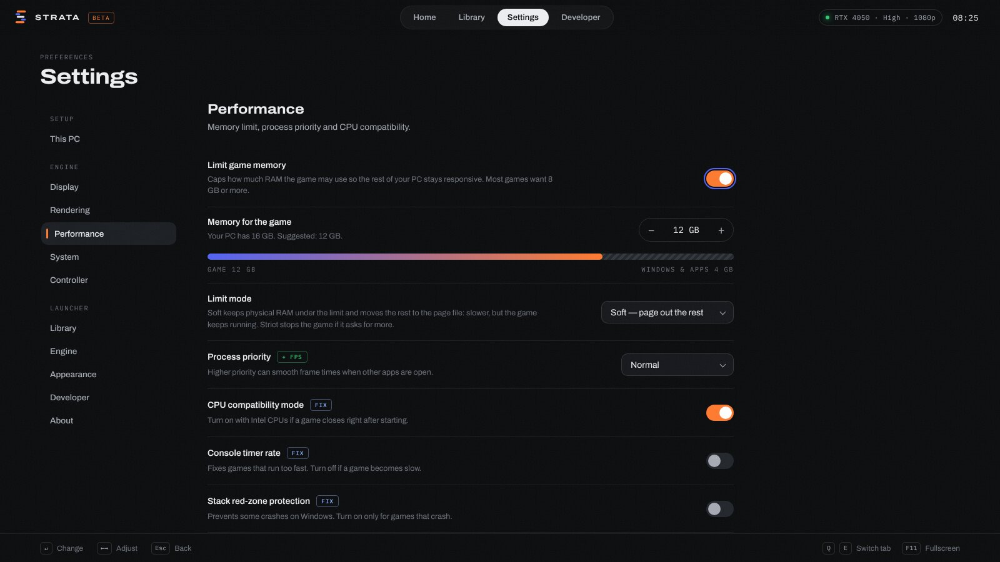
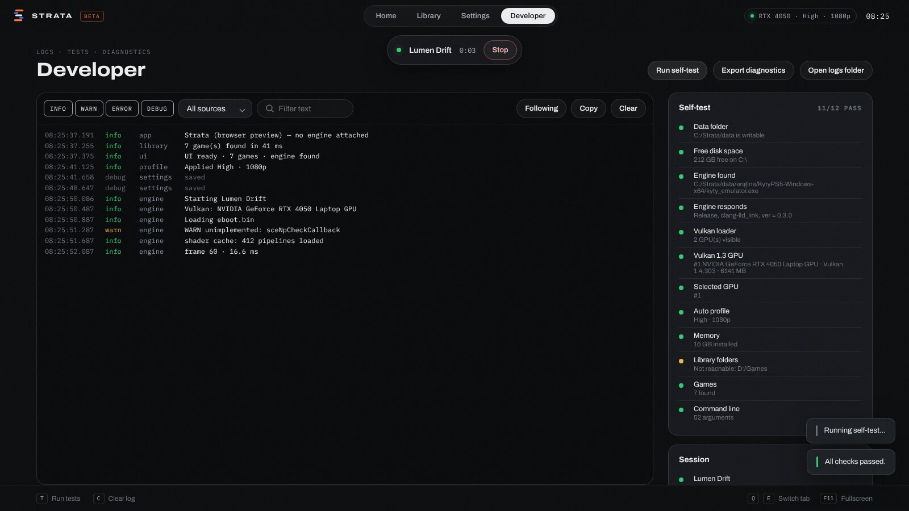

<p align="center">
  
</p>

<h1 align="center">Strata</h1>

<p align="center">
  A calm, open-source game launcher for PS5 game dumps on Windows.<br>
  It drives three open-source engines, falls back from one to the next, tunes itself to your PC and steps aside the moment you press Play.
</p>

<p align="center">
  <b>Website:</b> <a href="https://strata.gbxstudios.com">strata.gbxstudios.com</a> ·
  <a href="../../releases">Download</a> ·
  <a href="https://strata.gbxstudios.com/guide">Guide</a> ·
  <a href="https://strata.gbxstudios.com/report">Report a bug</a>
</p>

<p align="center">
  
  
  
  
</p>

<p align="center">
  
</p>

---

## What it does

| | |
|---|---|
| **Three engines, one Play button** | Games run on [KytyPS5](https://github.com/KytyPS5/KytyPS5), [SharpEmu](https://github.com/sharpemu/sharpemu) or [AnyPS5](https://github.com/boykopovar/AnyPS5). If an engine crashes or closes right away, the next one starts automatically and every attempt goes to the log; the engine that worked is remembered per game. |
| **Learns which engine fits** | Reads each game's `eboot.bin` — the system functions and libraries it needs, and whether it was made with Unreal, Unity or another engine. When an engine fails, Strata notes what was missing and uses that for every other game; after the first launch a game opens straight in the engine that worked. A per-game Compatibility page shows the chance for each engine. |
| **Community results** | Opt-in and anonymous: test results go to the [compatibility list](https://strata.gbxstudios.com/compatibility), and everyone's results help Strata pick the engine that works. |
| **Stats, filters and TV mode** | Time played and engine success rates, Works / Untested / Failed filters, and a big-screen mode for the couch (F9). |
| **Tunes itself to your PC** | Reads your GPU, CPU and memory through Vulkan — the same way the engine sees them — and applies a profile. An RTX 4050 laptop starts at 1080p, an RTX 3050 at 720p. Laptops with two GPUs are pinned to the dedicated one; Intel CPUs get compatibility patches switched on. |
| **A shelf, not a spreadsheet** | Games appear with their own cover and background art. Browse with a controller, keyboard or mouse. Favorites, play time, status and notes for every game. |
| **Memory limit with − and +** | Decide how much RAM a game may use. *Soft* keeps physical memory under the limit and pages out the rest; *strict* closes the game if it goes over. |
| **Settings that say what they cost** | Every option is tagged **+ FPS**, **− FPS**, **Fix**, **Experimental** or **Debug**. |
| **Per-game settings** | Give one game its own display, rendering, performance, controller keys and engine; changed options are marked with a dot, and one button goes back to the global settings. |
| **Refresh rate that follows your monitor** | *Auto* reads the monitor Strata is on — 144 Hz, 280 Hz, anything — and passes it to the engine. |
| **Keyboard and mouse keys** | One key map written in the engine's own format (AnyPS5), per game if you want. |
| **Save backups** | Back up the saves of one game or of all of them (shader caches optional) into a single zip and put them back later. |
| **Developer mode** | Live engine logs with filters, a twelve-point self-test, the exact engine command line and a one-click diagnostics report. |
| **Small and quiet** | Tauri + Rust on top of the WebView2 already in Windows: a ~10 MB app that sits idle while you play. |
| **No strings** | GPL-2.0. No accounts, no telemetry, no ads. It goes online only to download engines (GitHub) and, if you turn it on, to share anonymous test results. |

<p align="center">
  
  
</p>
<p align="center">
  
  
</p>

## Get started

1. Download the installer or the portable zip from **[Releases](../../releases)**.
2. On first launch the welcome screen checks your PC, downloads the engines from their official GitHub releases and creates a `Games` folder.
3. Put game folders you dumped from your own console in that folder (or add the folder where they already are) and press **Play**.

**Requirements:** Windows 10 (1803+) or 11, 64-bit · x86-64 CPU with AVX2 · Vulkan 1.3 GPU with a current driver · 16 GB RAM recommended.

Full guide — every setting explained, memory limit, per-game settings, troubleshooting and exit codes: **[strata.gbxstudios.com/guide](https://strata.gbxstudios.com/guide)**.

### Game folders

```
Games\
  My Game\
    eboot.bin
    sce_sys\param.json     title, ID, version
    sce_sys\icon0.png      cover
    sce_sys\pic0.png       background
    strata\logo.png        optional: your own transparent logo
  Another Game.zar         ZArchive, mounted read-only
```

A folder only counts as a game when it has `eboot.bin` **and** `sce_sys/param.json`; tools and payload folders are skipped (Developer mode lists them). PS4 support is built but switched off in this release.

### Engines

| Engine | Strata starts it with | Keys from Strata |
|---|---|---|
| KytyPS5 | full command line built from your settings | its own layout |
| SharpEmu | `SharpEmu <eboot.bin>` | its own layout |
| AnyPS5 | converts the game once, then runs the result | yes (`anyps5-input.ini`) |

Downloads go to `data/engines/<engine>/bin`; each engine's saves and caches live in `data/engines/<engine>/user`, so updating an engine never touches them.

## Important

- Strata **does not include, download or link to games, firmware, BIOS files or keys.** Use only games you dumped from hardware you own.
- Game compatibility comes from the engines, which are young and changing fast. They run many 2D and indie games; big 3D games often stop at menus or do not start yet.
- Game discs cannot be read in a PC drive — they are encrypted. Any download claiming otherwise is malware.
- Strata is an independent project, **not affiliated with any console manufacturer**.

## Building from source

The app is a Tauri 2 project: Rust backend in `src-tauri/`, plain HTML/CSS/JS frontend in `ui/` (no bundler).

```bash
# requirements: Rust (stable), Node 18+, and on Windows the MSVC build tools + WebView2
cd src-tauri && cargo test --lib       # 53 unit tests
cd .. && npx @tauri-apps/cli@^2 build  # app + NSIS installer in src-tauri/target/release
```

No local toolchain? Push to `main` and GitHub Actions builds Windows binaries (`.github/workflows/build.yml`). Pushing a `v*` tag publishes a release with the installer, the portable zip and `SHA256SUMS.txt`.

UI preview without the app: serve `ui/` with any static server and open `index.html` — `ui/js/api.js` falls back to demo data. `tests/ui_smoke.py` drives that preview in three window sizes with Playwright and fails on any error.

### Layout

```
src-tauri/src/
  engines.rs    the four engines: detection, command lines, fallback order
  engine.rs     KytyPS5 command line, starting/watching an engine, exit codes
  controls.rs   one key map → shadPS4 / AnyPS5 control files
  community.rs  opt-in anonymous results to the website, community knowledge download
  discord.rs    Discord Rich Presence (needs APP_ID)
  compat.rs     eboot.bin analysis, engine failure findings, per-game records, engine scores
  backups.rs    save + shader backups (zip with a manifest)
  pkginstall.rs PS4 package install (built, switched off by PS4_ENABLED in lib.rs)
  display.rs    monitor refresh rate for "Auto"
  gpu.rs        Vulkan device list (same order as the engine's --gpu index)
  profile.rs    automatic tiers per GPU family / VRAM
  memcap.rs     RAM limit (working-set cap or job object) and priority on Windows
  games.rs      library scan, param.json / param.sfo, custom art
  settings.rs   settings.json with per-game overrides
  logs.rs       ring buffer, daily log, per-session engine logs
  selftest.rs   developer self-test
  download.rs   official releases of every engine from GitHub
ui/             interface (boot, home, library, settings, developer)
tests/          UI smoke test
```

## Reporting bugs

Use the **[report form on the website](https://strata.gbxstudios.com/report)** or open an issue here. Turn on *Settings → Developer*, reproduce the problem, then attach the file from *Developer → Export diagnostics*.

## Credits & license

- **[KytyPS5](https://github.com/KytyPS5/KytyPS5)** (GPL-2.0, based on [Kyty](https://github.com/InoriRus/Kyty)), **[SharpEmu](https://github.com/sharpemu/sharpemu)** (GPL-2.0) and **[AnyPS5](https://github.com/boykopovar/AnyPS5)** (GPL-2.0) — the engines that run the games. Strata downloads them from their own releases and does not change them.
- **[orbis-pkg / orbis-pkg-util](https://github.com/videobitva/orbis)** (MIT OR Apache-2.0, used under MIT) — PS4 package reading and extraction.
- **[Tauri](https://tauri.app)**, **[ash](https://github.com/ash-rs/ash)**, **sysinfo**, **ureq**, **zip** and the Rust ecosystem.
- Fonts: **Archivo** and **IBM Plex Mono** (SIL Open Font License 1.1, see `ui/fonts`).

Strata is free software under the **GNU General Public License v2.0** — see [LICENSE](LICENSE).
