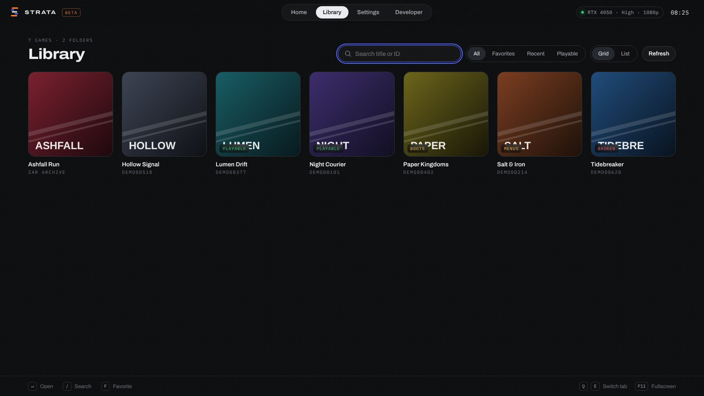

<p align="center">
  
</p>

<h1 align="center">Strata</h1>

<p align="center">
  A calm, open-source game launcher for the <a href="https://github.com/KytyPS5/KytyPS5">KytyPS5</a> engine on Windows.<br>
  It tunes itself to your PC, keeps your library tidy and steps aside the moment you press Play.
</p>

<p align="center">
  <b>Website:</b> <a href="https://strata.gbxstudios.com">strata.gbxstudios.com</a> ·
  <a href="../../releases">Download</a> ·
  <a href="https://strata.gbxstudios.com/guide">Guide</a> ·
  <a href="https://strata.gbxstudios.com/report">Report a bug</a>
</p>

<p align="center">
  
  
  
  
</p>

<p align="center">
  
</p>

---

## What it does

| | |
|---|---|
| **Tunes itself to your PC** | Reads your GPU, CPU and memory through Vulkan — the same way the engine sees them — and applies a profile. An RTX 4050 laptop starts at 1080p, an RTX 3050 at 720p. Laptops with two GPUs are pinned to the dedicated one; Intel CPUs get compatibility patches switched on. |
| **A shelf, not a spreadsheet** | Games appear with their own cover and background art. Browse with a controller, keyboard or mouse. Favorites, play time, status and notes for every game. |
| **Memory limit with − and +** | Decide how much RAM a game may use. *Soft* keeps physical memory under the limit and pages out the rest; *strict* closes the game if it goes over. |
| **Settings that say what they cost** | Every option is tagged **+ FPS**, **− FPS**, **Fix**, **Experimental** or **Debug**. |
| **Per-game settings** | Give one game its own display, rendering and performance options; the rest follow your global settings. |
| **Developer mode** | Live engine logs with filters, a twelve-point self-test, the exact engine command line and a one-click diagnostics report. |
| **Small and quiet** | Tauri + Rust on top of the WebView2 already in Windows: a ~10 MB app that sits idle while you play. |
| **No strings** | GPL-2.0. No accounts, no telemetry, no ads. The only network request is to GitHub when you ask it to download the engine. |

<p align="center">
  
  
</p>
<p align="center">
  
  
</p>

## Get started

1. Download the installer or the portable zip from **[Releases](../../releases)**.
2. On first launch the welcome screen checks your PC, downloads the official KytyPS5 engine and creates a `Games` folder.
3. Put game folders you dumped from your own console in that folder (or add the folder where they already are) and press **Play**.

**Requirements:** Windows 10 (1803+) or 11, 64-bit · x86-64 CPU with AVX2 · Vulkan 1.3 GPU with a current driver · 16 GB RAM recommended.

Full guide — every setting explained, memory limit, per-game settings, troubleshooting and exit codes: **[strata.gbxstudios.com/guide](https://strata.gbxstudios.com/guide)**.

### Game folders

```
Games\
  My Game\
    eboot.bin
    sce_sys\param.json     title, ID, version
    sce_sys\icon0.png      cover
    sce_sys\pic0.png       background
    strata\logo.png        optional: your own transparent logo
  Another Game.zar         ZArchive, mounted read-only
```

## Important

- Strata **does not include, download or link to games, firmware, BIOS files or keys.** Use only games you dumped from hardware you own.
- Game compatibility comes from the **KytyPS5** engine, which is young and changing fast. Many 2D and indie games run well; others reach menus or do not start yet.
- Game discs cannot be read in a PC drive — they are encrypted. Any download claiming otherwise is malware.
- Strata is an independent project, **not affiliated with any console manufacturer**.

## Building from source

The app is a Tauri 2 project: Rust backend in `src-tauri/`, plain HTML/CSS/JS frontend in `ui/` (no bundler).

```bash
# requirements: Rust (stable), Node 18+, and on Windows the MSVC build tools + WebView2
cd src-tauri && cargo test --lib       # 25 unit tests
cd .. && npx @tauri-apps/cli@^2 build  # app + NSIS installer in src-tauri/target/release
```

No local toolchain? Push to `main` and GitHub Actions builds Windows binaries (`.github/workflows/build.yml`). Pushing a `v*` tag publishes a release with the installer, the portable zip and `SHA256SUMS.txt`.

UI preview without the app: serve `ui/` with any static server and open `index.html` — `ui/js/api.js` falls back to demo data. `tests/ui_smoke.py` drives that preview in three window sizes with Playwright and fails on any error.

### Layout

```
src-tauri/src/
  engine.rs     finds the engine, builds its command line, runs a game, explains exit codes
  gpu.rs        Vulkan device list (same order as the engine's --gpu index)
  profile.rs    automatic tiers per GPU family / VRAM
  memcap.rs     RAM limit (working-set cap or job object) and priority on Windows
  games.rs      library scan, param.json, custom art
  settings.rs   settings.json with per-game overrides
  logs.rs       ring buffer, daily log, per-session engine logs
  selftest.rs   developer self-test
  download.rs   official engine releases from GitHub
ui/             interface (boot, home, library, settings, developer)
tests/          UI smoke test
```

## Reporting bugs

Use the **[report form on the website](https://strata.gbxstudios.com/report)** or open an issue here. Turn on *Settings → Developer*, reproduce the problem, then attach the file from *Developer → Export diagnostics*.

## Credits & license

- **[KytyPS5](https://github.com/KytyPS5/KytyPS5)** — the engine that runs the games (GPL-2.0), based on [Kyty](https://github.com/InoriRus/Kyty) (MIT).
- **[Tauri](https://tauri.app)**, **[ash](https://github.com/ash-rs/ash)**, **sysinfo**, **ureq**, **zip** and the Rust ecosystem.
- Fonts: **Archivo** and **IBM Plex Mono** (SIL Open Font License 1.1, see `ui/fonts`).

Strata is free software under the **GNU General Public License v2.0** — see [LICENSE](LICENSE).
